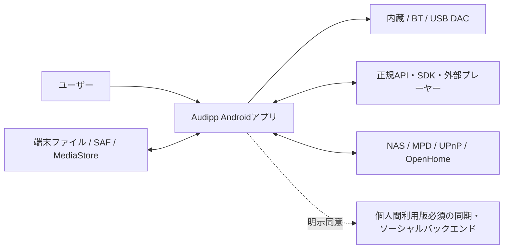
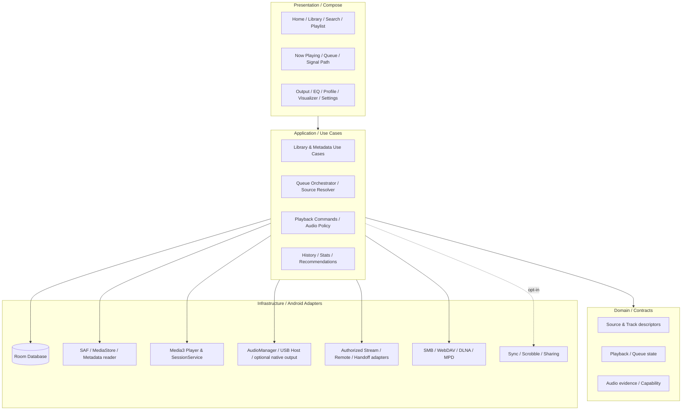
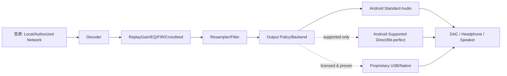
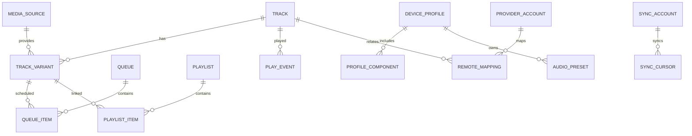
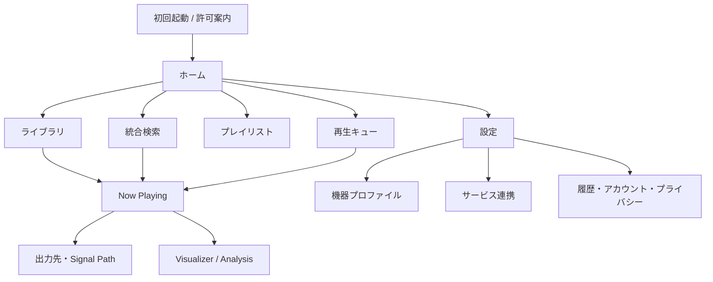
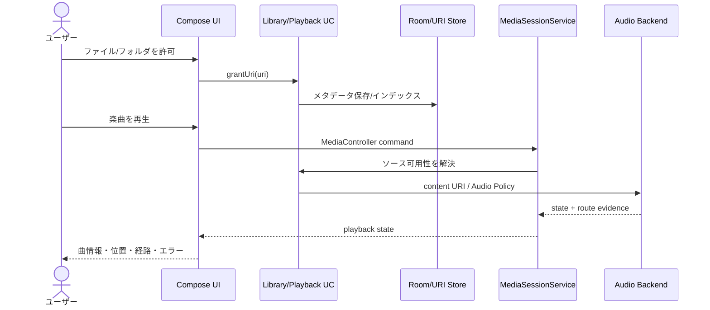
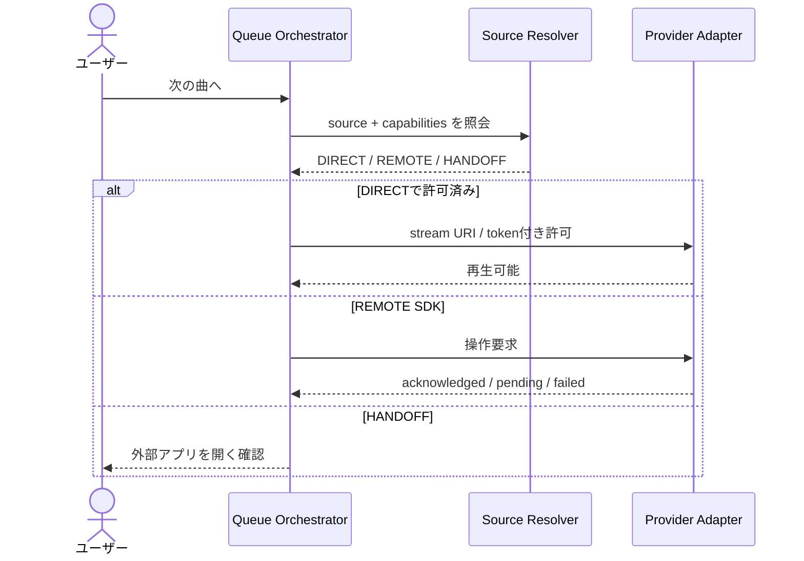

# Audipp 個人間利用の完成版 基本設計書（System Architecture / HLD）

| 項目 | 内容 |
|---|---|
| レビュー状態 | **Complete**（2026-10-28、利用者による全レビュー完了・正式版承認） |
| 文書ID | AUD-HLD-001 |
| 文書版・作成日・更新日 | 1.0.1 / 2026-10-26 / 2026-10-29 |
| 準拠 | [要件定義書](01_requirements.md)、原典 `docs/audio_app_feature_list.md` |
| 対象 | PoCを拡張して招待した個人間で使う**完成版Androidアプリ** |
| 設計状態 | **設計系レビュー終了・実装着手用アーキテクチャ**（2026-10-28利用者指定）。外部条件・Native DSD/USB等の導入・実機検証は該当領域へ引き継ぐ。現行範囲の必須機能を省く判断や、完成・一般公開の承認とは分ける。 |

## 1. 設計目標と基本方針

1. **コアのユーザー体験は統一、再生責務は分離**。ローカル、許諾済みストリーミング、公式アプリ遠隔制御、ネットワークレンダラーを同じUIから扱いつつ、許される操作はソースごとに異なる。
2. **再生主体はActivityから独立**。バックグラウンド再生、通知、ロック画面の状態はServiceに所有させる。
3. **音声経路の正確性を最優先**。ユーザーが設定した値と、OS申告、再生中の観測値、外部実測を別のデータ型・UIに保持する。
4. **高音質経路とDSPは明確に排他管理**。Bit-perfect出力と信号を書き換えるDSPは同時に保証できない。
5. **権限最小化、ローカル優先**。アカウント・通信不通でもローカル再生は成立する。
6. **将来機能を見越しつつ過剰設計しない**。現状の `app` 単一Gradleモジュールを維持し、責務の境界をパッケージで作る。分離が必要になった実測上の理由でモジュール化する。
7. **正式公開可能な権利の範囲で動作**。外部ストリーミングの非公式なPCM取得を共通再生エンジンの前提としない。

主要検証機はGalaxy S25（Android 16）・FiiO M21（OS版未確認）、DAC候補はiFi audio ZEN DAC V2・水月雨ECHO-B/ECHO-A。PCMは384 kHz/32-bit、DSDはDSD256を上限とし、通常2ch・最大5.1chは試験機能とする。上限超・機器非対応PCMは対応形式へ変換する。未確認のOS/firmware・実能力は実機で記録する（DD-AUD-05、DD-TEST-04）。無料・広告なし、日本公開、日本語/英語UI、自前サーバーという製品方針を採用する。

## 2. 開発基盤（確認済み現状と採用案）

| レイヤ | 現状 | 完成版の採用案 |
|---|---|---|
| OS | Android、minSdk 23、targetSdk 36 | Androidスマートフォン／DAP（最低OS最終確定は互換試験後） |
| 言語／UI | Kotlin 2.3.10、Compose Material 3 | Kotlin、Compose、Navigation、ViewModel＋StateFlow |
| ビルド | Gradle 8.13、AGP 8.13.2、JDK17 | 既存Wrapperとバージョンカタログ／lockfileを維持 |
| 再生 | 未実装 | Media3 1.11.1 ExoPlayer + MediaLibraryServiceを設計採用 |
| 永続化 | 未実装 | Room 2.8.5（曲・キュー・履歴）＋Preferences DataStore 1.2.1（小規模設定）。認証情報は適切な保護ストレージ |
| 同期／バックエンド | 未実装 | 個人間利用版必須。認証・同期・フレンド・機器共有を実装し、Debian/Docker上でKeycloak認証、Kotlin/Ktorの業務API、PostgreSQLを分離。論理契約は08_design_decisions.md、配備詳細はP-02/03 |
| 高度なPCM/DSD/USB | 未実装 | ハード能力・公式API・配布許諾の成立後に専用バックエンドを追加 |
| 自動検証 | ユニットテスト3件、ビルド手順あり | CI: Unit/Integration/Lint/Release Build、実機音声検査は別経路 |

**選定根拠・未検証範囲**：[技術設計決定記録](08_design_decisions.md)に依存版のAAR下限確認とサーバー構成・同期規則を記録する。依存追加・実ビルド・配備は未実施。

**Media3採用理由**：Android向けメディア再生・セッション・OS統合の既存実装を再利用できる。Media3だけでNative DSD／全DAC Bit-perfectを実現できるという意味ではない。形式のサポートは端末デコーダー等に依存する。参照：<https://developer.android.com/media/media3/exoplayer/supported-formats>。

## 3. システムコンテキスト

### 信頼境界

- **TB-01** 端末内部：アプリ保存領域、SQLite、再生ServiceはAudipp管理下。
- **TB-02** SAF／USB：OSが権限を仲介。ファイルURIは任意の`content://`を含み、実ファイルパスとは限らない。
- **TB-03** 外部サービス：認証・再生許諾・利用制限・サービス側データ品質を信頼境界の外に置く。
- **TB-04** LAN：SMB/WebDAV/UPnP等の端末・家庭内機器が返す情報を無条件に信用しない。
- **TB-05** クラウド：アカウント／同期が選択される場合のみ送信され、個別同意を必須とする。

## 4. 論理アーキテクチャ

**依存規則**：UIは低レベルAndroid APIを直接呼ばない。UseCaseは契約を通じInfrastructureにアクセスする。例外はUI固有のAndroid Picker起動などPresentationレイヤ固有処理で、結果のURIはUseCaseへ渡す。

## 5. 音源モデルと統合ソース戦略

### 5.1 再生方式（5種類）

| モード | 所有する再生主体 | 典型例 | Audippが可能なこと | 制限 |
|---|---|---|---|---|
| `LOCAL_DIRECT` | Audipp | 端末内音源、許可されたネットワーク音源 | デコード／再生、キュー、可能ならDSP・Visualizer | OS・DRM・形式・出力機器制約 |
| `PARTNER_DIRECT` | Audipp（権利がある場合） | 許諾済みストリーミング | 契約範囲で同エンジン制御・DSP等 | API認証、ストリーム形式、契約上のDSP可否 |
| `PARTNER_REMOTE` | 提供元公式アプリ／SDK | 遠隔制御の参考分類（Q-01の達成には不採用） | 公式SDKが許す再生操作と情報表示 | PCMへのアクセス不可、外部キュー操作制限 |
| `EXTERNAL_HANDOFF` | 提供元公式アプリ／Web | サービスへのdeep link | 遷移、対応情報表示 | Audippから状態取得・連続制御できない場合あり |
| `NETWORK_REMOTE` | 外部レンダラー | MPD / OpenHome / UPnP | 許可された遠隔制御・状態参照 | 実際の音声出力は外部機器。音声解析不可の場合あり |

Q-01により全ストリーミングサービスの要求方式はPARTNER_DIRECTとし、REMOTE/HANDOFFを直接再生の代替にしない。これらの分類は補助遷移やエラー説明のために残す。Q-02によりYouTube系はyt-dlp経由の音声のみとし、映像のRenderer・動画UIを設けない。実装手段・用途別許諾・配布条件はR-06で確認する。

### 5.2 統合キューの意味

統合キューは**曲の順序と実行可能性を管理する論理オブジェクト**。すべての曲をAudippのPCMパイプラインで再生する保証ではない。

- 各`QueueItem`は一意なVariant参照を持ち、音源の`SourceRef`と、選択出力先・許諾から求める`ExecutionPlan`を分ける。modeとcapabilitiesはPlanに属し、出力先変更で再評価する。曲長・収録曲順・形式は版ごとに保持する。
- `PARTNER_REMOTE`曲へ切替時は公式プレーヤーの同期完了・許諾・必要なユーザー操作を確認する。
- `EXTERNAL_HANDOFF`は自動で次曲へ進める前提にしない。ユーザー確認を促し、時間予測の不確かさを表示する。
- `LOCAL_DIRECT`内など連続制御できるグループのみギャップレスを検証する。
- 提供元やキューの内部状態に関する齟齬は、明示的な再同期で回復する。
- 再生主体の切替はCoordinatorで直列化する。旧主体の停止を確認できなければ次の自動開始を保留し、手動停止と継続確認を提示する。取消後の遅延成功にも停止を要求し、未確認状態を表示する（DD-QUEUE-04）。
- Providerの技術能力と用途別許諾は別に記録する。混在表示・キュー、履歴・統計・推薦・外部送信、PCM加工・解析は該当用途の許諾を確認したときだけ有効化する。未確認を許可にしない。

## 6. 再生・信号処理の基本設計

この図は**概念上の信号経路**。実装時はMedia3がデコードから出力まで内部に保有する経路も存在するため、すべての端末で`Decoded PCM`へ任意のライブラリを差し込めると想定しない。高度なPCM/DSDルートは、検証済みのバックエンド内にまとまった経路として実装する。

### オーディオモード

| モード | 設定原則 | 可否の判定 |
|---|---|---|
| `STANDARD` | Android標準パス、幅広い互換性 | 標準APIで動作確認 |
| `PROCESSED` | 対応PCM経路でDSP/リサンプルが動作 | 実際のDSPグラフ有効時に表示 |
| `DIRECT_ATTEMPT` | OSが許すDirect/Preferred Mixerを要求 | OSのAPI戻り値＋実際の適用状態を区別 |
| `BIT_PERFECT_VERIFIED` | 出力無変更を所定の条件で検証した場合だけ表示 | 端末×DAC×形式×接続方法×設定×試験証跡 |
| `NATIVE_DSD` / `DOP` | DAC・OS・ライセンスに応じて有効化 | 転送形式とDAC挙動を実測する |

Android 14以降のUSB優先Mixer属性は、対応HALによるBit-perfect属性が**オプション**。アプリが出力希望レートを設定しただけでは検証済みにならない。参照：<https://source.android.com/docs/core/audio/preferred-mixer-attr>。

### 情報の証拠階層

`SOURCE`（音源の属性）/ `REQUESTED`（要求）/ `OS_REPORTED`（OS申告）/ `APP_OBSERVED`（アプリ観測）/ `EXTERNAL_VERIFIED`（外部実測）/ `UNKNOWN`（未取得）。別の階層で取得した値を、上位の確証へ自動昇格させない。

### デバイス安全性

- USB DACの再接続、Bluetooth→有線、プロファイル切替時は、音量の適用順序を制御。元の音量を無条件に戻さない。
- 物理アンプの利得をアプリが調整したと偽らない。高感度イヤホンの警告を表示。
- 出力機器のVID/PIDと名前だけで機器の完全一致を断定しない。接続IDや利用者選択を組み合わせる。
- リモート再生時の安全音量もレンダラーのAPI範囲に限り制御可能とする。

## 7. データ設計（論理モデル）

- **Track**：楽曲メタデータ。再生可能な物理ファイルまたは権利許諾済みの配信アイテムとは1対1に固定しない。
- **TrackVariant**：ファイル形式・マスター・解像度・サービス版を識別。誤同定を修正できる。
- **PlaybackCheckpoint**：現在キューrevision・現在エントリー・最後に保存した位置を同じDBで保持。確定イベントと再生中の定期保存で更新し、プロセス終了通知には依存しない。復元後は再生操作を待つ。
- **MediaSource**：URIアクセス・公式SDK・ネットワーク取得の種類、可否と期限を持つ。
- **Queue / QueueItem**：履歴として並びを保存し、進行中のエントリーIDを追跡。順番は再生とは別管理。
- **Playlist / PlaylistItem**：キューとは異なり、永続的にユーザーが保存したコレクション。
- **PlayEvent**：再生回数と時間の集計元。後で再計算可能な事実のみ保存。
- **DeviceProfile / AudioPreset**：デバイス組合せと音声設定の論理分離。
- **ProviderAccount / RemoteMapping**：サービス固有IDと権限、期限、同一曲紐付け。
- **SyncAccount / SyncCursor**：個人間利用版に必須の同期状態。基盤はKeycloak/Ktor/PostgreSQL。私用の配備先詳細は未確認。利用者が同期を使うかどうかは任意で、ローカル再生のログイン必須化を意味しない。

正規化・主キー・制約・永続化／マイグレーションは[詳細設計書](03_detailed_design.md)で定める。

## 8. 主要画面とナビゲーション

- **Home**：最後の再生・よく使うソース・最近の履歴・対応サービスの状態。
- **Library/Search**：メタデータでの横断検索。結果はソース別に利用可否を示す。
- **Now Playing**：再生主体、出力先、音源形式、操作可否、キュー進捗。
- **Output & Signal Path**：ソース・DSP・経路・DACの各値と証拠ラベル。
- **Visualizer**：対象はAudippがアクセスできる許諾済みPCMのみ。外部アプリの内部音声を取得したかのようなUIを禁止。
- **Settings**：一般設定と高度な音声設定を分け、危険操作を確認する。
- **Accessibility**：主要アクションはTalkBackラベル／状態読み上げ、文字拡大、非色情報で区別。
- **段階差**：PoCのトップレベルは`docs/design.md`のLibrary中心案を用い、ここで示すHomeは完成版の案とする。FR-UI-03のテーマ3モードとFR-UI-06の共通ミニプレイヤーは両段階に適用する。

## 9. 動作シーケンス（基本）

### 9.1 ローカル再生

### 9.2 サービス統合キュー

**非同期遷移規則**：remoteで「指示受理」と「実際の再生開始」は異なる。タイムアウト／取消／失効を持ち、ユーザーへ状態を表示する。

## 10. 外部インターフェース・権限方針

| 先 | 主なインターフェース | 権限・安全条件 |
|---|---|---|
| 端末ファイル | Storage Access Framework / MediaStore | URIの許可・永続化・失効処理。Android 11以降の制限を遵守 |
| Android OS | Media3 Session, AudioManager, AudioTrack系, AudioDevice callback | `mediaPlayback` foreground serviceと適切なManifest。出力観測できるAPI範囲内 |
| USB DAC | UsbManager / OS Audio API / 承認済み独自Backend | 接続・通信時の許可。OSドライバーとの競合回避は実機検証 |
| Streaming | OAuth・公式SDK・公式API | PKCE等の公式フロー、利用規約、DRM、データ制限、トークン保護 |
| LAN | SMB/WebDAV / UPnP / OpenHome / MPD | ユーザー明示設定、ネットワークと資格情報保護 |
| Backend | 個人間利用版用HTTPS API | 最小データ、認証、退会・削除、可監査な契約 |

Android公式：<https://developer.android.com/training/data-storage/shared/documents-files>、<https://developer.android.com/media/media3/session/background-playback>、<https://developer.android.com/develop/connectivity/usb/host>。

## 11. 非機能・運用アーキテクチャ

### 11.1 オフライン

- 曲・キュー・ローカル履歴・デバイスプロファイルは端末内永続化。
- ネットワークが切れてもローカル再生は維持する。外部ソースの未取得データは明示的なエラー／一時停止扱い。
- サービスの自動再試行は指数バックオフとAPIレート制限を尊重し、重複課金・二重コマンドに注意。

### 11.2 プライバシー

- データ区分：公開不要（端末内部）／利用者が共有許可／外部SDKが直接保持するデータ。
- 同期・フレンド・ランキングを使う場合、機能別同意と公開範囲、送信先・データ保持期間、削除手段を明示。
- ログ・障害報告のデフォルトはローカル。アカウント名／絶対パス／アクセストークン／フルジャケット画像の収集を抑止。

### 11.3 可観測性

- `PlaybackEvent`, `RouteEvent`, `ProviderEvent`, `ErrorEvent` は単調増加のイベント順序とタイムスタンプを持つ。
- OSとDACの値は「取得時点・出典・信頼性」を記録。メトリクスの欠損を0値に補完しない。
- デバッグログはサンプリング・上限・マスキングを実装し、共有時は利用者がプレビューする。

### 11.4 リリース・CI

- **高音質価値の公開ゲート**：原典の全PCM/DSD・DSP・USB・解析方式を、定義した対応環境で実装・測定する。いずれか1方式で他方式を代替しない。一般的なOS再生をBit-perfectと呼ばない。
- **統合価値の公開ゲート**：全サービスの直接再生と混在キューを必須とし、カタログ検索は可能なら実装する。YouTube系はyt-dlp・音声のみとする。Q-01/02の方式をリモート制御・外部遷移で代替せず、実装手段・許諾・実証が不足すれば該当機能を未完了とする。
- `main`はPR経由、Debug Build/Unit Test/Lint/Release BuildをCIで実行。
- 公式署名鍵・OAuth秘密情報はGitHubに平文コミットしない。個人間版は署名APK、SBOM、第三者ライセンス一覧を作成。ストア提出AABはPUBLIC。
- 自動テストと、USB DAC／高感度イヤホン／ビット忠実性等の実機検査は別判定。
- ストア公開前は`targetSdk`、権限、プライバシーポリシー、SDK規約を再確認する。

## 12. セキュリティ・障害時の基本対応

| 障害 | 基本方針 | 利用者への挙動 |
|---|---|---|
| URI権限喪失 | 失効ソースを再要求・再スキャン | 「再選択してください」 |
| ファイル破損・形式不可 | 問題の曲のみスキップ／停止 | 理由・回復ボタン・ソース表示 |
| USB/BT切断 | 安全にPauseまたは対応済み経路へフェイルセーフ切替 | 音量変更防止、出力先表示 |
| PCM/DSDバックエンド非対応 | 利用可能方式の候補を再評価 | 自動フォールバックは明示設定・安全条件に限定 |
| Provider認証失効 | Refresh可能なら実行、それ以外は再ログイン | ローカル再生は継続可 |
| API利用停止・DRM不可 | 機能を無効化し代替公式アプリへ誘導 | 使えない理由と公式遷移 |
| LAN切断 | 再接続可能状態に保持、履歴やキューは保持 | 端末選択・再試行 |
| DB破損 | 整合性チェック・安全な復旧・バックアップへ退避 | 無断のデータ全消去禁止 |
| 端末処理負荷 | Visualizer品質低下、重いDSPをオフにできる | 再生安定性を優先 |

## 13. 完成に向けた実装順序（リリース範囲を縮小しない）

| 先行順 | 設計・実装する領域 | 完了判定の観点 |
|---|---|---|
| W1 | ローカル音源、Session、ライブラリ、キュー | エラーを含むローカル再生が安定 |
| W2 | 出力観測、安全性、Signal Path、実機マトリクス | 不明値を正しく扱い、切断で安全 |
| W3 | 正規サービス連携、統合キューの能力制約 | 全サービスの直接再生・許諾・キュー、可能なサービスの検索を検証 |
| W4 | DSP・PCM/DSD・USB高度機能の個別バックエンド | 機種別に実証されたものだけ提供 |
| W5 | ネットワーク再生、Visualizer、履歴／推薦、機器プロファイル | 各種統合・電力・プライバシー試験 |
| W6 | 同期・アカウント・ソーシャル・機器共有 | 本人データ管理・バックエンド運用準備 |
| W7 | 性能・アクセシビリティ・セキュリティ・私用配備 | UAT＋端末実測＋署名APK更新・復旧を満たす。ストア審査等は完成後 |

これは開発順序であり、W1〜W7すべてが個人間利用版の前提である。未採用機能を設けて工程を省略しない。原典の適用条件とOS対象外方針を維持し、未達は完成判定保留とする。

全箇条書きの対応は[個人間利用版機能対応表](05_feature_coverage.md)、判断の質問は[判断事項・回答シート](06_decisions.md)を参照する。

## 14. 設計の決定ゲート（ADR）

| ADR ID | 判断を要する内容 | 現時点の推奨 |
|---|---|---|
| ADR-001 | 再生Service | MediaLibraryServiceを設計採用。MediaLibrarySession/PlayerをServiceで所有 |
| ADR-002 | USB Direct／Nativeバックエンド | 標準経路とlibusb 1.0.29のUAC経路を分離。Native/DoPは09の転送契約と機器試験で判定 |
| ADR-003 | DSP・リサンプラーのライブラリ | 処理品質・電池・ライセンス・ソースPCM取得可能性で比較 |
| ADR-004 | Streaming provider別の直接再生手段 | Q-01でDIRECT必須と確定。実装手段・用途別許諾はR-06。REMOTE/HANDOFFへの置換はしない |
| ADR-005 | Backend採用と運用責任 | 個人間利用版に必須。Q-06〜12回答に基づき自前サーバー、メール/Google等認証・削除までの履歴保持を採用。構成・同期は08、招待/復旧/保持は09。私用配備の実環境だけP-02で確認 |
| ADR-006 | DB競合・曲の一意性 | 08_design_decisions.mdの所有権・event_id・revision・cursor・原子的バッチ規則を採用。誤同定は解除可能 |
| ADR-007 | OS/ABI互換性維持 | API23/compile36を維持し、Media3 1.11.1/Room 2.8.5/DataStore 1.2.1を設計採用。推移依存と実ビルドは導入時に確認 |
| ADR-008 | 観測結果・Bit-perfect表示基準 | 実証された端末とテスト条件を公開一覧に紐づける |

## 15. 要件への対応表

| 要件群 | 主要コンポーネント | 詳細設計 |
|---|---|---|
| FR-SRC | Source Repository, LibraryIndexer, ProviderAdapter | DD-SRC、DD-DB、DD-PROV |
| FR-PLY | QueueOrchestrator, MediaSessionService | DD-PLY、DD-QUEUE |
| FR-AUD | OutputPolicy, AudioBackend, DSPGraph | DD-AUD、DD-DSP |
| FR-DEV | RouteMonitor, DeviceRegistry, ProfileMatcher | DD-DEV |
| FR-NET | RemoteRendererAdapter, NetworkLibrary | DD-NET |
| FR-USE | HistoryRecorder, SyncGateway, RecommendationEngine | DD-HIST、DD-CLOUD |
| FR-OBS | SignalPathSnapshot, VisualizerPipeline | DD-OBS |
| FR-UI | Compose Screen/ViewModel | DD-UI |
| FR-PLT / NFR | CI、互換性・品質マトリクス、リリースゲート | DD-TEST、DD-RELEASE |

2026-10-28追補：DSP/USBの採用先、音声順序・QLT基準、LAN/タグ方式、私用認証とPUBLIC延期は[順次レビュー](09_private_completion_review.md)に従う。全領域の外部条件解決を待ってローカル実装を止めない。

2026-10-29 Apple Music除外：利用者指示により、2026-10-28のApple Music追加方針を撤回。公式MusicKit/Apple Music API、署名API・認証・検索/再生AdapterとCider参考の独自PCM研究を実装・試験・完成条件から除外する。現行対象はQobuz・Spotify・YouTube/YouTube Music。DD-PROV-06は廃止IDとして保持する。

2026-10-28サービス範囲改訂：Amazon Music/SoundCloudを実装・完成条件から除外。qobine参考Qobuz、librespot PCM Sinkを調査候補とする。Apple独自PCM候補は2026-10-29に対象外へ変更した。詳細は[添付候補の照合](10_provider_proposal_review.md)。公式SDK再生と自前PCM供給を区別し、Provider障害をローカル再生へ波及させない。添付の独立モジュール案は責務境界として扱い、単一app方針やNative導入時期を無断変更しない。

2026-10-28 yt-dlp方式決定：[サーバー中継・保存選択](11_ytdlp_delivery.md)を採用。サーバーで音声取得/中継し端末で再生する。既定は保存しないstream、希望時はAudippがSAFの選択フォルダへ保存する。音声の再圧縮は原則行わず、再生/保存状態とcache/確定音源を分離。端末のyt-dlp内蔵は後段候補で、API23引上げの前提にしない。サーバー解決URLだけを返す案と音声の中継を区別する。
