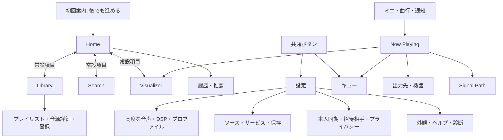

# E03-01 / #19：完成版ナビゲーション・状態遷移のUIレビュー案

| 項目 | 記録 |
|---|---|
| 日付・版 | 2026-10-31 JST / Proposal 1 |
| 状態 | **Implementation Proposal / 人間によるUIレビュー待ち** |
| 調査基点 | origin/main `ba0628b212a1ad736622f8fdb7be8d194c2eaf94` |
| 対象 | [Issue #19](https://github.com/4rtoflow/Audipp/issues/19)、個人間利用版の画面構成・状態・戻り先 |
| 根拠 | [design.md §4・7・8](../design.md)、[HLD §8](02_basic_design.md#8-主要画面とナビゲーション)、[DD-UI / DD-UI-02 / TEST-UI-01](03_detailed_design.md)、[PRD §1.3・3.8](01_requirements.md) |
| 承認者・承認日・承認commit | **未定・未承認・なし**。この案の作成、自己検証、PR作成を承認記録にしない |

既存仕様1.0.1とdesign.md 1.0.0の承認状態を変更しない。本書の画面ID、配置、戻る規則、幅の数値は実装提案であり、承認済み製品条件を置き換えない。`MainActivity`から`WelcomeScreen`を表示する現状を確認した。以下の画面群やナビゲーションは未実装である。

## 1. 比較と採否案

| 候補 | 利点 | 制約・代償 | 本レビューでの扱い |
|---|---|---|---|
| Library / Search / VisualizerのPoC案 | ローカル音源未登録からの追加が近い。架空の推薦を置く必要がない | 完成版の履歴・推薦・接続ソースの入口がLibraryへ集中する | PoCの比較元として維持。完成版の推奨にはしない |
| HLDのHome中心案 | 再開・履歴・接続ソースをまとめ、ローカルとサービスを見渡せる | Homeから毎回Libraryへ入るだけでは操作が増える。図だけではタブ・戻り先が決まらない | Homeを起動先とする案を推奨し、Libraryも常設の入口にする |
| Home / Library / Search、VisualizerはNow Playing配下のみ | ナビゲーションが3項目で収まる | 停止中のプリセット設定、ABX・解析への入口が再生画面に偏る | 比較案。Visualizer独立項目を推奨する理由は到達性 |
| **Home / Library / Search / Visualizer** | Libraryへ直接移動でき、Now Playing経由と独立した可視化入口を両立する | 狭い画面で4項目のラベルを検証する必要がある。解析不可でもタブ自体は開ける | **推奨案、採用判断待ち** |

設定は共通トップバーのボタンに置き、タブには含めない。キューも共通トップバーから開く。プレイリストはLibraryから、履歴・推薦はHomeから開く。Homeは取得済みの再開情報・履歴・ソース状態だけを表示し、初回は「音源を追加」からローカル登録へ進める。アカウント案内やサービス障害でHome全体を覆わない。

Visualizerの独立タブは解析の実行許可を意味しない。未再生・無音・解析不可を区別し、利用可能な設定と理由を表示する。対象PCMがなければメーターを動かさない。Apple Music / Amazon Music / SoundCloud、動画UI、一般向け自己登録・自動メール・公開一覧・問い合わせ・ストア画面は追加しない。

## 2. 共通遷移・戻る規則（提案）

- ナビゲーションの各項目、トップバーの設定・キュー、曲行の再生、ミニプレイヤーの展開はボタンとして操作できる。ドラッグ・スワイプだけを入口にしない。
- 4つのトップレベルはそれぞれ一覧位置・検索条件・配下の履歴を持つ。項目切替でその履歴を復帰し、選択中の項目を再選択したらそのルートへ戻る。再選択で検索語・フィルターを消さない。
- Androidの戻るは、確認ダイアログ→シート→全画面表示→現在の履歴の順で1段閉じる。ツールバーの戻る・縮小ボタンでも同じ画面へ戻れる。入力キーボードが開いていればAndroidの戻るは先にキーボードを閉じる。
- トップレベルのルートで戻るとHomeへ移る。Homeルートで戻るとActivityを離れる。再生停止コマンドは送らない。別タブを経由した循環履歴は積まない。
- 一覧・検索・キューから再生を要求したら、共通再生入口の受付結果を受けてNow Playingを開く。拒否なら元画面に理由を出す。受付後のBuffering/Seeking/失敗はNow Playingに表示する。戻る先は要求元の行・条件を含む画面。
- ミニプレイヤーの展開では再生要求を送らず、現在の閲覧画面を戻り先としてNow Playingを重ねる。フルプレイヤー・没入型Visualizerに重複したミニを置かない。通常画面では共通ミニをナビゲーションの上に確保し、シートやキーボードに隠れている間も再生状態を別に作らない。初回・現在曲なしでは再生ボタンを押せるように見せず、音源追加へ進める。
- 表の「親」は直接起動で履歴がない場合の戻り先。履歴があれば実際の呼出元を優先する。親も削除・失効して復元できなければ同じトップレベルのルート、ルート不明ならHomeへ戻す。
- 編集中に離れる場合は保存／破棄／編集に戻るを明示する。安全音量、全消去、解除、削除は各機能の確認・取消契約を使う。画面を開く操作だけで適用・認証・外部送信を始めない。
- 回転・幅変更・テーマ変更では同じ画面ID・選択ID・検索語・フィルター・一覧位置・未保存編集を保持する。再生はServiceの共通Snapshotを購読し直し、Playerを再生成しない。プロセス復元時はIDと現在の権限・能力を再検査し、削除済み項目には復旧先を表示する。自動再生の可否を本案で新たに決めない。
- 通知・ウィジェットのアプリ起動操作はNow Playingへ進む。現在曲がなければHomeへ進む。履歴なしの戻る先はHome。認証callbackは元の認証要求と照合し、取消・失効なら成功にせずProvidersまたはAccountへ戻す。URI・トークンを画面IDや復元データへ含めない。



## 3. 全画面の到達表（提案）

画面IDは文書内の参照用で、ルート型や公開APIの追加ではない。`ROOT`はHOMEへ渡すアプリの起点であり、画面ではない。全行の入口はタップ／TalkBackで実行するボタンまたは一覧項目。親の画面が空・読込・エラーでも、設定・キュー・常設4項目は操作できる。外部認証・OS選択画面はアプリ内画面とは分けて§5で扱う。

| ID | 表示・DD-UI対応 | 親 | 親からの明示的な入口 | 状態型 |
|---|---|---|---|---|
| HOME | ホーム / UI-01 | ROOT | 初回案内の「後で」・「完了」、起動 | COLLECTION |
| LIBRARY | ライブラリ / UI-02 | HOME | 常設「ライブラリ」 | COLLECTION |
| SEARCH | 検索 / UI-03 | HOME | 常設「検索」 | SEARCH |
| VISUALIZER | 可視化・解析 / UI-08 | HOME | 常設「Visualizer」、Now Playingの可視化 | ANALYSIS |
| SETTINGS | 設定 / UI-11 | HOME | 共通「設定」 | SETTINGS |
| NOW | Now Playing / UI-04 | HOME | ミニ展開・曲の再生受付、共通キューの現在曲 | PLAYBACK |
| QUEUE | キュー / UI-05 | HOME | 共通「キュー」、Now Playingのキュー | COLLECTION |
| SOURCE | 音源管理・登録進捗 / UI-02 | LIBRARY | 「音源を追加・管理」 | SOURCE |
| ALBUM | アルバム詳細 / UI-02 | LIBRARY | アルバム行 | COLLECTION |
| ARTIST | アーティスト詳細 / UI-02 | LIBRARY | アーティスト行 | COLLECTION |
| TRACK | 楽曲情報・音源版選択 / UI-02 | LIBRARY | 曲の情報、Search・Queue・Now Playingの曲情報 | DETAIL |
| METADATA | タグ・アート・照合・関連付け / UI-02 | TRACK | 「情報を編集・照合」 | EDITOR |
| PLAYLISTS | プレイリスト一覧 / UI-02 | LIBRARY | 「プレイリスト」 | COLLECTION |
| PLAYLIST | 曲一覧・名前・順序の編集 / UI-02 | PLAYLISTS | プレイリスト行・作成 | EDITOR |
| HISTORY | 履歴・統計・ランキング / UI-10 | HOME | 「履歴」 | COLLECTION |
| RECOMMEND | 推薦・理由・スマートプレイリスト / UI-10 | HOME | 「推薦」 | COLLECTION |
| OUTPUT | 出力選択・レンダラー / UI-07 | NOW | 「出力先」 | DEVICE |
| DEVICE | 機器詳細・能力・取得元 / UI-07 | OUTPUT | 機器の詳細 | DEVICE |
| SIGNAL | Signal Path / UI-06 | NOW | ソース情報・「信号経路」 | DETAIL |
| AUDIO | 高度な音声設定 / UI-06 | SETTINGS | 「オーディオ」 | EDITOR |
| DSP | EQ・FIR・ReplayGain等 / UI-06 | AUDIO | 「DSP」 | EDITOR |
| PROFILES | 機器・組合せプロファイル / UI-07 | SETTINGS | 「機器プロファイル」 | EDITOR |
| VIZ_SETTINGS | 可視化プリセット・感度・色・FPS / UI-08 | VISUALIZER | 「表示設定」 | EDITOR |
| VIZ_FULL | 没入型Visualizer / UI-08 | VISUALIZER | 「全画面」 | ANALYSIS |
| ABX | ABX条件・試行・結果 / UI-08 | VISUALIZER | 「ABX比較」 | ANALYSIS |
| PROVIDERS | サービス・LAN連携 / UI-09 | SETTINGS | 「音源・サービス連携」 | CONNECTION |
| PROVIDER | サービス認証・用途別許諾、LAN接続編集 / UI-09 | PROVIDERS | 対象サービス・LAN接続行 | CONNECTION |
| SAVES | 希望した音源の端末保存・進捗 / UI-09 | PROVIDERS | 「端末への保存」、対象曲の保存操作 | SOURCE |
| ACCOUNT | 招待制ログイン・本人同期・復元 / UI-12 | SETTINGS | 「アカウント・同期」 | CONNECTION |
| FRIENDS | 招待相手・比較・共通嗜好・ブロック / UI-12 | ACCOUNT | 「フレンド」 | CONNECTION |
| PRIVACY | 公開範囲・同意・削除・エクスポート・退会 / UI-12 | SETTINGS | 「データとプライバシー」 | EDITOR |
| APPEARANCE | 外観・テーマ3モード / UI-11 | SETTINGS | 「外観」 | SETTINGS |
| CUSTOM_THEME | カスタムテーマ編集・既定復帰 / UI-11 | APPEARANCE | 「カスタムテーマ」 | EDITOR |
| WIDGET | ウィジェットの設定・追加案内 / UI-11 | SETTINGS | 「ホーム画面ウィジェット」 | SETTINGS |
| HELP | ヘルプ・機能制限・音量安全・データ扱い・ライセンス / UI-11 | SETTINGS | 「ヘルプ・アプリ情報」 | DETAIL |
| DIAGNOSTICS | 計測値・診断ログの確認と出力 / UI-11 | SETTINGS | 「診断」 | DETAIL |

Libraryの曲／アルバム／アーティスト／フォルダ／ジャンル／年／形式とSearchの提供元切替は、同一画面内のラベル付きフィルターとし、選択条件を保持する。曲詳細からアルバム・アーティストへも開け、戻ると曲詳細へ戻る。Metadata内で重複・異マスター・音源版を修正・解除できる。Playlist内の固定リストと条件式は区別する。Queueの並べ替えには移動ボタン、削除には取消を備え、スワイプを必須にしない。

PROVIDERはQobuz / Spotify / YouTube / YouTube Music / Last.fmと、SMB / WebDAV / UPnPライブラリの設定入口を含む。MPD / OpenHome / UPnPレンダラーの選択・接続設定はOUTPUT配下に置く。技術能力と用途別許諾は別に表示する。SAVESは許可された保存希望からのみ開始し、完了確認前を保存済みにしない。PROFILESは機器DBの公称・本人申告・実測を分け、共有操作は招待相手と範囲を確認してPRIVACYの同意条件へ従う。

## 4. 各画面の状態と復旧先（提案）

表示状態と再生状態・権限・操作の可否は別々に保持する。例えば曲一覧がContentでも一部曲だけ再生不可になり得る。音源変更時は前曲の取得値を消してから新しい曲を表示する。既存データを残す更新中はそのデータの対象と更新失敗を示す。

共通の遷移は `Loading → Content / Empty / Error`。利用者の明示操作から再試行したらLoadingへ戻る。権限・許諾の不足はPermission、能力なしはUnsupportedとして理由を表示する。実際に該当しない状態を作る必要はなく、その場合は表中の扱いを用いる。§3の全画面へ次の状態型を適用し、どの状態でも§2の戻る規則を維持する。

| 状態型 | 通常 | 空 | 読込 | エラーと復旧 | 権限・認証・用途許諾 | 未対応 |
|---|---|---|---|---|---|---|
| COLLECTION | 取得した一覧・状態 | Library/HomeはSOURCEへ追加、Queue/PlaylistはLibraryへ追加、History/推薦は記録不足とLibrary入口 | 取得済み件数のみ。全体不明なら%なし | 一覧内に理由・再試行。片方のソース失敗で他を隠さない | 該当ソースにSOURCE/PROVIDER/PRIVACYへの復旧ボタン。ローカル閲覧は残す | 該当行の操作を無効化し理由・HELPを表示 |
| SEARCH | 語・条件別の結果 | 語未入力と0件を区別し語・条件の変更 | 検索語変更で旧要求を取消し、旧応答で結果を上書きしない | 失敗した提供元に再試行 | 失効元だけPROVIDERへ。ローカル結果を残す | 検索非対応の提供元と理由。直接再生まで省略しない |
| PLAYBACK | Playing/Paused、現在曲と能力 | 現在曲なし、Library入口 | Buffering/Seekingを実状態から表示 | 失敗曲と原因・再試行・別ソース選択。再生成功にしない | SOURCE/PROVIDERで復旧後、明示した再生操作へ戻る | シーク等を理由付き無効化。外部制御の申告を内部再生と呼ばない |
| SOURCE | 登録先・scan/保存の実進捗 | 追加または許可された保存先選択 | 全体不明は不定進捗。取消ボタン | 失敗項目・容量不足等と再試行。検証前を完了扱いしない | OS再選択。拒否・失効時は現画面に留まり再選択/戻る | 読めない形式・保存用途不許可を理由付き表示 |
| DETAIL | 対象情報・出典・取得位置 | 対象削除/記録なしを示し親へ戻る | 未取得は不明、他対象の値を表示しない | 読取・出力失敗を示し再試行/取消 | 外部照合・ログ出力・データ送信は同意先へ進む | 未取得と非対応を区別。Signal Pathの値一致だけでBit-perfectとしない |
| EDITOR | 保存値と編集中の値・適用結果を分離 | 作成、既定復帰、対象なしなら親へ戻る | 保存・適用待ち。二重送信を止める | 編集値を残して再試行/破棄。適用失敗を成功にしない | 同意/認証先へ明示遷移。本人変更で以前の編集を別本人へ保存しない | 能力外設定を無効化し理由。危険な変更は適用前確認 |
| DEVICE | 接続先とOS申告/観測値 | 機器なし、接続/再検出 | 発見/能力取得中。実出力の確定は待つ | 切断・拒否を表示し再検出/出力選択 | USB等のOS許可へ。取消は同画面 | 不明能力を推定せず、未対応方式は無効化 |
| ANALYSIS | 許諾済みPCMの取得位置・方式 | 未再生と無音を区別。Library/Now Playingへ | 解析準備/ABXデータ読込中 | 解析停止と再試行、ABX中断。偽の値や結果を作らない | 不許可・PCMアクセス不可の理由。PROVIDER/PRIVACYへの復旧入口 | 外部経路等の解析不能を明示、設定と戻るは操作できる |
| CONNECTION | 接続・認証・同期・共有の現在状態 | 未設定/未ログイン。利用者の選択で接続/ログイン | 取消可能な接続/認証/同期表示 | 認証失効と通信/サーバー障害を分離。再認証/再試行/取消 | 未許諾・他人の範囲にはデータを表示しない。ローカルへ戻れる | 機能ごとの不可理由。一般向け自己登録を代替入口にしない |
| SETTINGS | 保存済み設定を表示 | 未保存は既定値、未読取とは区別 | 読取中は保存済みと断定しない | 保存・読取失敗と再試行。画面階層を失わない | 権限が必要な操作を選んだ時だけ案内 | ウィジェット追加のOS非対応等はHELPへ。テーマ選択は維持 |

Home→HISTORY/RECOMMEND、Library→SOURCE/PLAYLISTS、VISUALIZER→VIZ_SETTINGS/ABXは親が空・解析不可でも開ける。SOURCE/SAVES/PROVIDER等で処理を開始する条件と、画面を開く条件を分ける。未達の必須機能を理由表示だけで完成扱いにしない。

## 5. 外部UI・例外遷移（提案）

| 起点・イベント | 遷移・結果の渡し先 | 取消・失敗・戻る |
|---|---|---|
| 初回起動 | 音源権限の用途を案内し、選択した時だけOSファイル選択へ。「後で」でHOME | 権限拒否でもHOME・LIBRARY・SETTINGSへ進める。ログイン画面を必須にしない |
| SOURCEの追加/再選択、SAVESの保存先 | OSのSAF選択結果を要求元へ返して許可を再検査 | 取消は呼出元へ。保存やscanを成功にしない。登録済みの別ソースは維持 |
| PROVIDER/ACCOUNTの認証 | 対象を確認してシステムブラウザーを開き、検証したcallbackを要求元へ返す | 取消・失効・別要求のcallbackは成功にせず、再試行/ローカルへ戻る |
| OUTPUTの許可・出力切断 | OS許可結果/現在の経路をOUTPUT・DEVICE・SIGNAL・NOWへ反映 | 取消は元の出力を成功扱いで変更しない。切断時の継続/停止は再生ポリシーに従い、UI独自で再開しない |
| ログ出力・エクスポート | 内容確認→明示操作→OS保存/共有UI。完了結果をDIAGNOSTICS/PRIVACYへ返す | 取消・IO失敗は未完了。秘密・URI・音源を無断添付しない |
| WIDGETの追加 | 対応OSの追加UIまたはランチャー操作案内 | 取消はWIDGETへ。アプリ内設定画面を開いただけで配置済みにしない |
| 削除・失効したIDへの復元/外部起動 | 現在の利用可能性を確認し、元の画面に対象なしと親へのボタンを表示 | 親がなければ§2のフォールバック。別の曲や別人のデータへ置換しない |

## 6. 幅・横画面・アクセシビリティのImplementation Proposal

| 論点 | 提案 | 根拠と未検証事項 |
|---|---|---|
| 最小検証幅 | **利用可能なコンテンツ幅320dp**を設計検証の下限候補とする | 対応保証・製品の最小幅の承認ではない。320未満もクラッシュや画面切捨てを避け、1ペイン＋スクロールへ。正式対応表は実装時レビュー |
| 縦・狭幅 | 600dp未満は1ペイン、4項目の下部ナビゲーション＋その上にミニ | 320/4=80dpは48dpの操作領域を置ける計算に限る。英語ラベル・文字拡大・システム領域を含む可読性は未検証 |
| 中幅 | 600〜839dpはレール＋1ペインを候補とする | 下部の再生領域を確保。文字拡大や高さ不足なら1ペインでスクロール。数値は採用待ち |
| 広幅・横画面 | 840dp以上を2ペイン候補にし、一覧＋詳細、Now Playingはアート＋操作を並置 | 向きだけで2ペインにしない。レール等を除いた残幅・高さに収まらなければ1ペインへ。詳細の閉じるで選択元行へ戻る |
| 高さ不足 | アートを縮小し、曲情報・シーク・再生・キュー/出力/詳細へのボタンへスクロールで到達 | アートのために操作を画面外へ固定しない。320×480、640×320、マルチウィンドウを検査候補とする |

320/360/599/600/839/840dpの境界、横画面、文字倍率1.0/1.3/2.0、日本語/英語、Dark/LightとSystemの実効両配色を実装後に検査する。数値は本案の試験入力であり、Android標準や実機合格を主張しない。主要機はGalaxy S25/FiiO M21、追加機はS20。現時点で実際の利用可能dpやOS・文字倍率を測定していない。

全ボタンは48×48dp以上、選択中項目・再生状態・不可理由を色以外とTalkBackで示す。ラベルの長さに応じて折返し・配置変更し、必須のボタンを省略メニューやジェスチャーだけへ追い出さない。Now Playingや詳細を閉じたら、呼出元のミニ展開ボタンまたは選択行へフォーカスを戻す。呼出元が削除済みなら復旧先の見出しへ移す。読込完了やエラー更新でフォーカスを先頭へ移さない。モーション削減時も同じ遷移先を使う。

視覚的な追加文言は操作を識別するラベルを「必須」、空/拒否/未対応/失敗と復旧を「状態」、出典・時刻を「補助」とする。英語の飾り見出しや重複説明は追加しない。Help、権限・安全性・同意に必要な説明と読み上げラベルは省略しない。

## 7. 要求・試験の追跡と自己検証

以下は**文書モデルの検証**であり、Composeの操作試験・画面キャプチャ・実機合格ではない。検証対象commitはPRの「証跡」で固定する。本書自身に自己参照のcommit SHAを書かない。

| 検証ID | 要求 → 設計 → 試験 | 手順・照合対象 | 本提案の結果 |
|---|---|---|---|
| NAV-01 | FR-UI-01 → DD-UI → TEST-UI-01 | §3のID重複、存在しない親、親循環を検査し、HOMEから各親の入口を順にたどる | 36画面すべて到達、UI-01〜12を包含。行の存在は実データの生成保証ではない |
| NAV-02 | FR-UI-01, NFR-A11Y-01 → DD-UI-02 → TEST-UI-01 | §2・3で共通ボタン/常設項目/一覧項目から往復。ジェスチャー専用入口を探す | 主画面・配下画面に明示操作あり。TalkBackの実操作は未実施 |
| NAV-03 | FR-UI-02 → DD-UI-02 → TEST-UI-01 | 全36行に§4の状態型を割当て、通常/空/読込/エラー/権限/未対応と復旧先を照合 | 10状態型で全行を説明。権限や能力のない操作は成功表示しない |
| NAV-04 | FR-UI-01 / FR-UI-02 → DD-UI → TEST-UI-01 | 初回→後で→Home→Library→SOURCE、OS拒否→SOURCE→Library→Home。Account障害→戻る→設定→Home→Library | ログイン・ネットワークなしでローカル登録/閲覧の入口へ到達 |
| NAV-05 | FR-UI-01 / FR-UI-06 → DD-UI-02 → TEST-UI-01 | Search結果から再生受付→NOW→QUEUE→戻る→NOW→縮小→元のSearch語・行へ。拒否時はSearchに留まる | 呼出元を保存する規則で戻り先が一意。ミニ/通知とのSnapshot一致は未検証 |
| NAV-06 | FR-UI-02 → DD-UI-02 → TEST-UI-01 | Library詳細→削除/URI失効→再選択取消→詳細→戻る。履歴なしの失効ID→親→ルートへ | 取消を成功扱いせず、復旧不能でも閉じ込めない |
| NAV-07 | FR-UI-01 / FR-UI-02 → DD-UI-03 → TEST-UI-01 | NOW→Visualizer→全画面→戻る→Visualizer→戻る→NOW。タブ起点ではHomeへ。PCM拒否では設定と戻るを確認 | 入口ごとの戻り先あり。解析を偽装しない |
| NAV-08 | FR-UI-03, NFR-A11Y-01 → DD-UI-02 → TEST-UI-01 | 一覧/編集中にテーマ・幅・回転を変更する§2・6の状態保持規則を照合 | IDと編集を保持する設計。実装・dp/文字・画面キャプチャは未検証 |
| NAV-09 | FR-UI-02 → DD-UI-02 → TEST-UI-01 | §5のOS/ブラウザー取消、認証失効、出力切断、古いcallbackの結果と戻り先を照合 | 処理の成功/配置済み/保存済みと表示しない。実OS連携は未実施 |
| NAV-10 | FR-UI-01 / FR-UI-02 → DD-UI → TEST-UI-01 | §3をPRD §3のライブラリ/プレイリスト/音声/機器/LAN/履歴/同期/共有/解析/外観/ヘルプと照合 | 機能群の入口あり。画面内の個別操作の実装は所有Issueへ引渡し |

自己評価：PRDのログイン不要・個人間利用・対象外サービスを維持し、機能の除外は追加していない。デザイントークンと両配色は既存design.mdを参照し、色・ブランド・テーマの新しい採用値は作っていない。アクセシビリティは操作と復帰先の設計まで確認した。音声情報は音源・要求・OS申告・観測・実測を分け、測定できない値を補完しない。第三者のPRレビューは未完了。

NAV-01/03の表構造は、リポジトリ直下で次のPython標準ライブラリの検査を再実行できる。親から子への到達性を検査するもので、呼出履歴を使う実際の戻る処理はNAV-05〜09の設計レビューと実装後の操作試験で確認する。

```sh
python3 - <<'PY'
from pathlib import Path
import re

text = Path('docs/specifications/12_navigation_proposal.md').read_text()
inventory = text.split('## 3. ', 1)[1].split('## 4. ', 1)[0]
rows = [line.strip('|').split('|') for line in inventory.splitlines()
        if re.match(r'^\| [A-Z_]+ \|', line) and not line.startswith('| ID |')]
routes = {row[0].strip(): [cell.strip() for cell in row] for row in rows}
assert len(rows) == len(routes) == 36, '画面IDの重複または件数の不一致'
states = text.split('## 4. ', 1)[1].split('## 5. ', 1)[0]
profiles = set(re.findall(r'^\| ([A-Z]+) \|', states, re.M))
assert len(profiles) == 10
for route, row in routes.items():
    assert len(row) == 5 and row[3] and row[4] in profiles, route
    visited = set()
    while route != 'ROOT':
        assert route in routes and route not in visited, route
        visited.add(route)
        route = routes[route][2]
assert set(re.findall(r'UI-\d\d', inventory)) == {
    f'UI-{number:02}' for number in range(1, 13)}
print('PASS: 36画面、UI-01〜12、10状態型、親の存在・循環なし・ROOT到達')
PY
```

## 8. 承認待ち項目・引渡し・再開箇所

| 項目 | 本書の推奨 | 判定・次の作業 |
|---|---|---|
| 完成版の構成 | Home起動、Home / Library / Search / Visualizer | **未承認**。比較表と§3をUIレビューし、採用/不採用・理由・判断者・日付・対象commitを追記する |
| Visualizer独立タブ | 採用を推奨。Now Playingからも開く | **未承認**。解析不可状態と狭幅ラベルを含め判断する |
| 最小幅・適応境界・戻る規則 | §2・6 | **未承認・実機未測定**。画面実装時に計測してレビューする |
| #64 | 承認後のNavigation shell / Home / 初回案内 | 本書だけで依存解消としない。route型・保存機構・UIライブラリは同Issueで具体化 |
| #40 | テーマ3モード、トークン、保存・OS追従 | 承認済みテーマ要件は変更しない。本書はAPPEARANCEへの入口のみ |
| #84 | Library・詳細・登録進捗 | §3のID/呼出元復帰と§4の失効/取消を引渡す |
| #85 | Now Playing・ミニ・出力導線 | 共通Snapshot、受付/拒否、縮小先、QUEUE/OUTPUT/SIGNAL/VISUALIZERの入口を引渡す |

文書だけの変更のため、新しいUnit/Integration/Instrumented/Hardware試験の実行対象はない。2026-10-31 JST、JDK 17・既存SDKを使い、Gradleキャッシュ・出力を専用worktreeへ分離し、`source scripts/linux/android-env.sh`後の`./gradlew :app:assembleDebug :app:testDebugUnitTest :app:lintDebug`は成功した。既存JUnit 72件、失敗・エラー・skip各0。Lintはエラー0、依存更新通知9件（AndroidGradlePluginVersion / GradleDependency / NewerVersionAvailable）。§7の表構造検査と参照ID・追加リンクの検査も成功した。CIの結果と対象commitはPRへ記録する。

実機シリアルは未指定で端末操作なし。音声出力・DAC・性能・画面キャプチャ・ラベル削減前後比較・翻訳・テーマ保存・OS追従・全TEST-UI-01の達成は未検証。

再開時はPRの証跡commitとChecks、上記未承認3項目を確認し、レビュー結果を本書へ追記する。承認後に必要なdesign.md/HLD/DD-UI差分を別途反映する。マージ・auto-merge・Issue完了判定は本作業では行わない。
